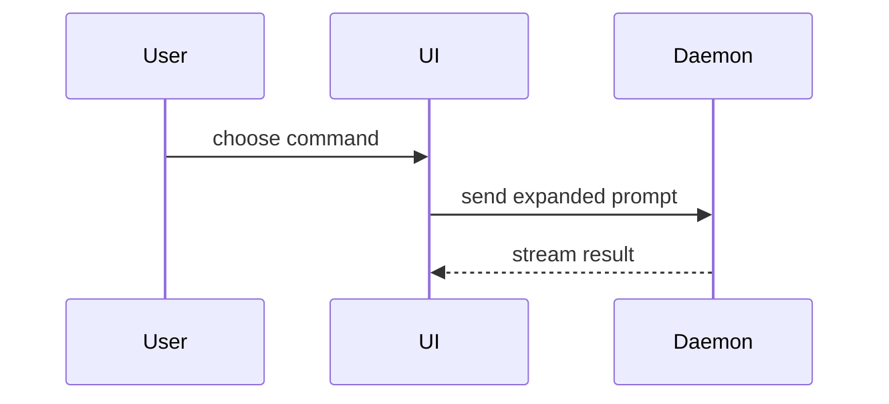

# PR Description

## Template

```markdown
## Summary

<diagram, diff-sketch, or tree>

## Evidence

- **Before:** <screenshot/output/failing test run>
  **After:** <screenshot/output/passing test run>

## Merge Danger

**Door:** <one-way or two-way>

<optional: description>

**Blast Radius:** <one-word description>

<optional: potential ramifications of merge>
```

## Sections

Use the user's domain language from `GLOSSARY.md` if it exists.

### Summary

Pick the smallest view that makes the key point clear.

- Show logic or an algorithm as pseudocode:

```text
on(save)
  if content is unchanged
    return cached result
  write new content
  return fresh result
```

- Show runtime control flow as a call tree:

```text
submitForm
  createSession
    persistPrompt
    launchAgent
  navigateToSession
```

- Show UI structure as a component tree, including state and module boundaries that matter:

```text
<SessionPage> (apps/example/src/routes/session.tsx)
  useSessionEvents()
  <SessionToolbar>
    <RunSkillButton> (packages/ui)
```

- Show file responsibility or a broad refactor as a shallow file tree:

```text
src/
├── commands/       # parses user actions
├── sessions/       # owns session state
└── transport/      # sends API requests
```

- Show component interaction, control flow, or data flow with Mermaid:



- Use `diff` when the point is what changes and the surrounding shape already exists. Match the diff shape to the topic.

For a component change:

```diff
 <SessionPage>
   useSessionEvents()
   <SessionToolbar>
+    <RunSkillButton />
   <SessionTimeline>
+    <SkillResultCard />
```

For a file-layout change:

```diff
 src/
 ├── commands/
+│   └── show-me.ts       # expands the slash command
 ├── sessions/
-└── transport.ts
+└── transport/
+    ├── client.ts
+    └── stream.ts
```

For a call-tree or call-stack change:

```diff
 submitForm
   createSession
     persistPrompt
+    expandSkillMention
     launchAgent
-  navigateToSession
+  navigateToSession
+    subscribeToEvents
```

For a state or control-flow change:

```diff
 on(save)
-  write content
+  if content is unchanged
+    return cached result
+  write new content
+  invalidate cache
```

- Show the whole block when most of it is new, when omitted context would hide ownership or order, or when the user needs a copyable target shape:

```ts
function expandSkill(command: string): string {
  const skillName = command.slice(1);
  return `use the ${skillName} skill`;
}
```

Place each visual next to the short text it supports. Keep only the calls, files, props, states, and boundaries needed to answer the reader's current question. Use one of these, or several — it's unlikely you'll use all of them. Don't overwhelm the reader.

### Evidence

Concrete evidence that the change works. Show a before and after.

Screenshots are S-tier — when the environment is set up for it and the change is visual.

Execution-based evidence is A-tier. Test results, console output. Show the exact test that now fails and passes, using pseudocode.

### Merge Danger

Describe whether it's a one-way or two-way door. You can walk back through two-way doors, but not one-way doors. A PR that is cheap to roll back is lower risk. Changes that involve destructive actions or hard-to-reverse decisions are one-way doors.

The blast radius is the potential impact or scope of the changes introduced by this PR. Consider all possibilities: layout shift, breakages for consumers, mobile responsiveness, etc.

## AI-isms check

Before handing the draft over, check it against the same rule `comment-check` applies to comments, adapted for a PR body:

- **No restatement.** Don't describe what the diagram or diff already shows in prose underneath it.
- **No historical framing.** Don't describe the change relative to what came before ("no longer does X", "now resolves Y", "simplified from Z", "instead of doing A"). A PR body describes the change that's landing, not a before/after narrative — that's what the diff view is for.
- **No hedge words or marketing adjectives.** Cut "robust", "comprehensive", "seamless", "simply", "just". If an adjective isn't doing load-bearing work (a scope word like "intermittent" or "read-only"), cut it.
- **No "this PR adds X which improves Y by doing Z" boilerplate.** Say what changed, in the Summary's visual; don't narrate the change in a sentence that restates the title.
- **No preamble.** Go straight into `## Summary`. No "This PR..." opening line at all.

Treat each of these as a finding to fix before showing the draft, the same way `comment-check` treats a restated comment — not a style preference to apply loosely.

## Credits

The Summary section's visual menu is adapted from Dex Horthy's [`show-me` skill](https://github.com/humanlayer/skills/blob/main/plugins/show-me/skills/show-me/SKILL.md) (Humanlayer).
